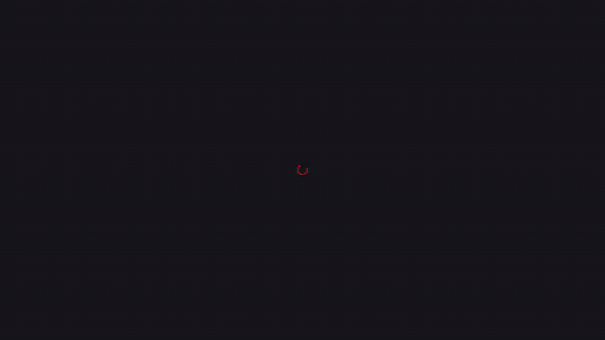
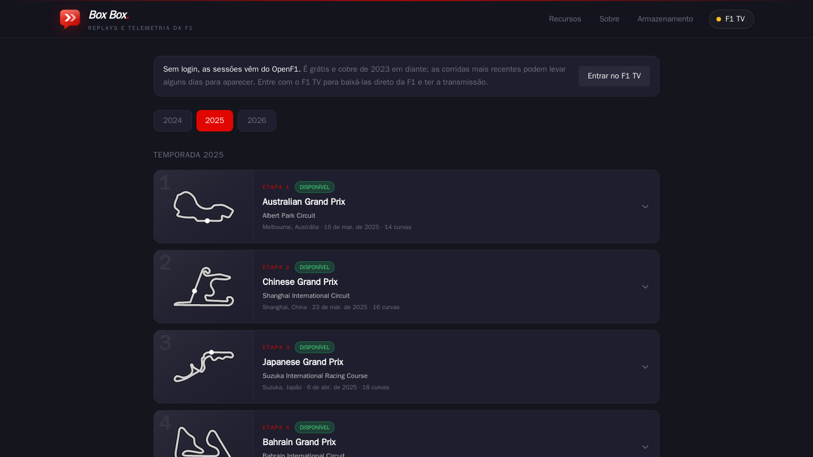
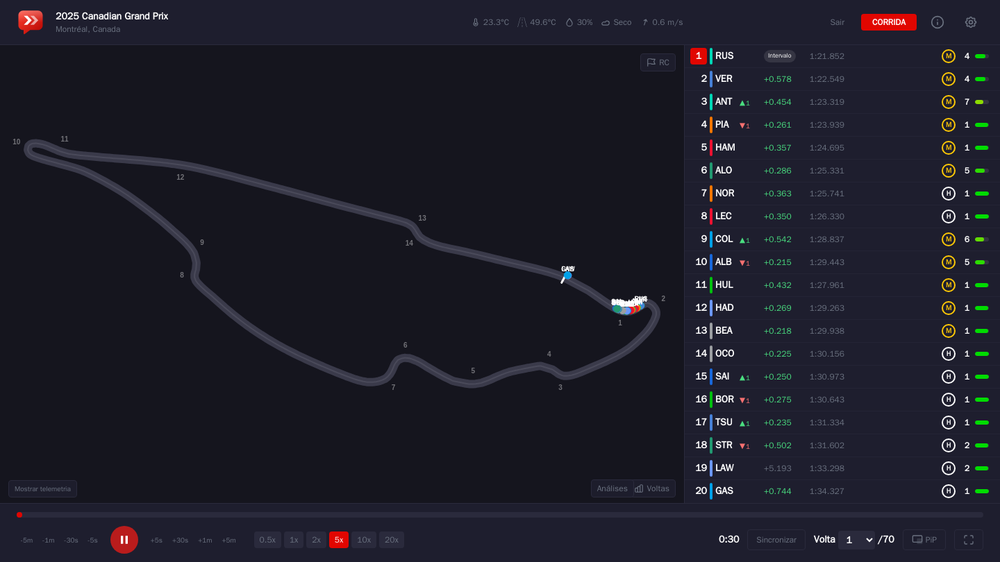
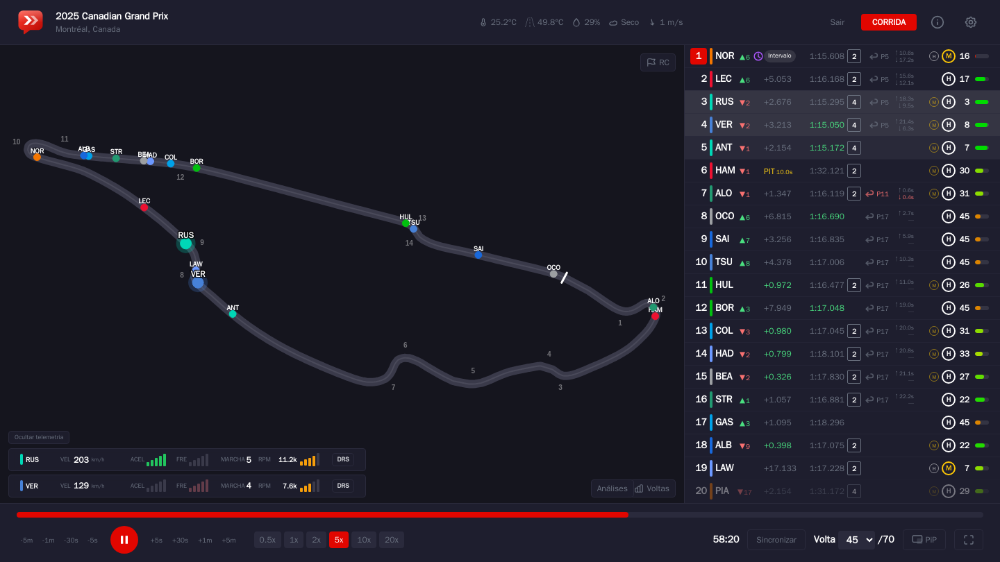
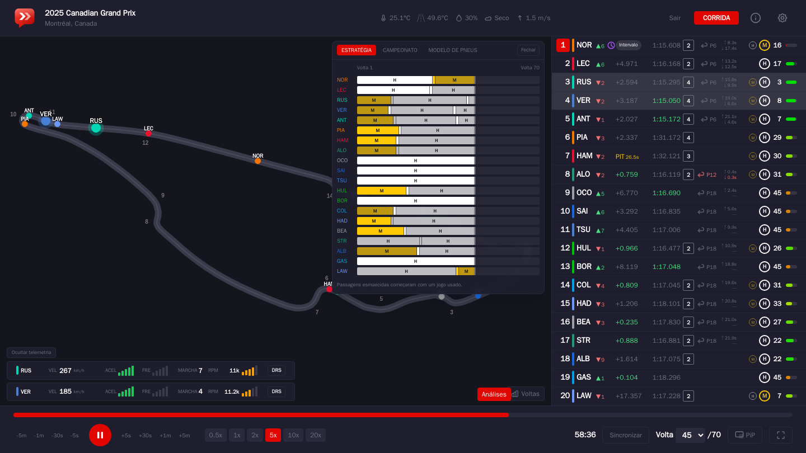
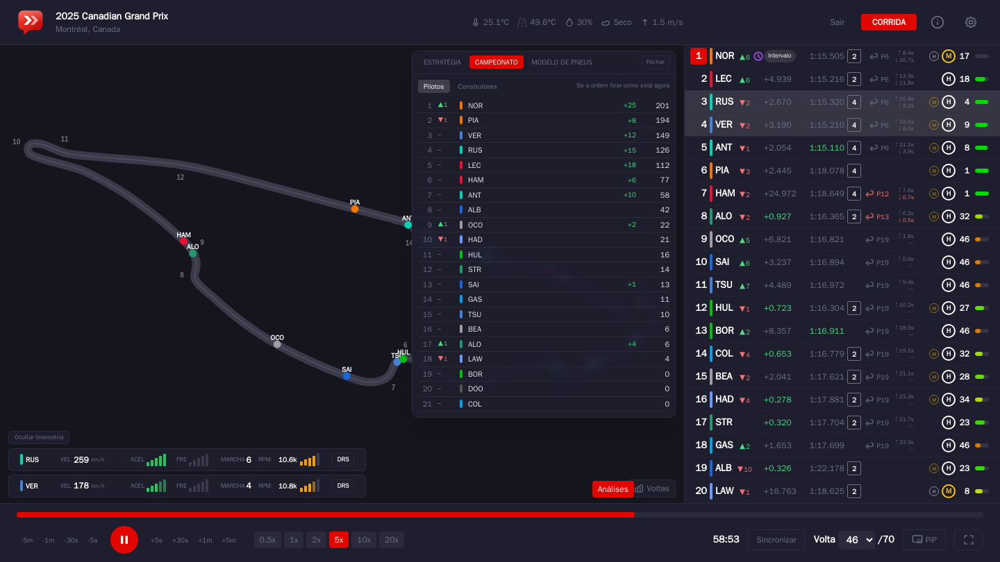
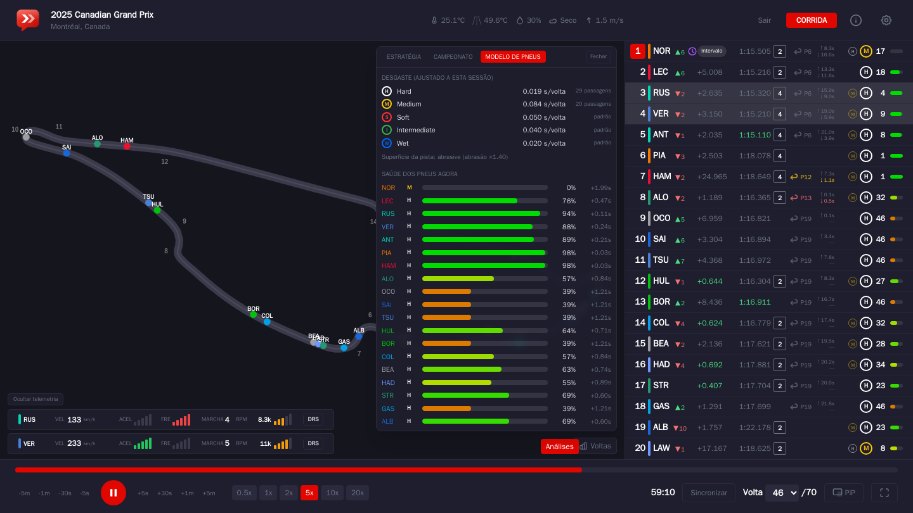
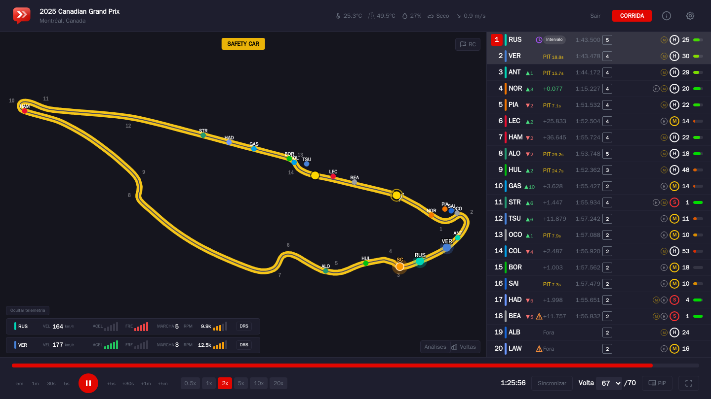
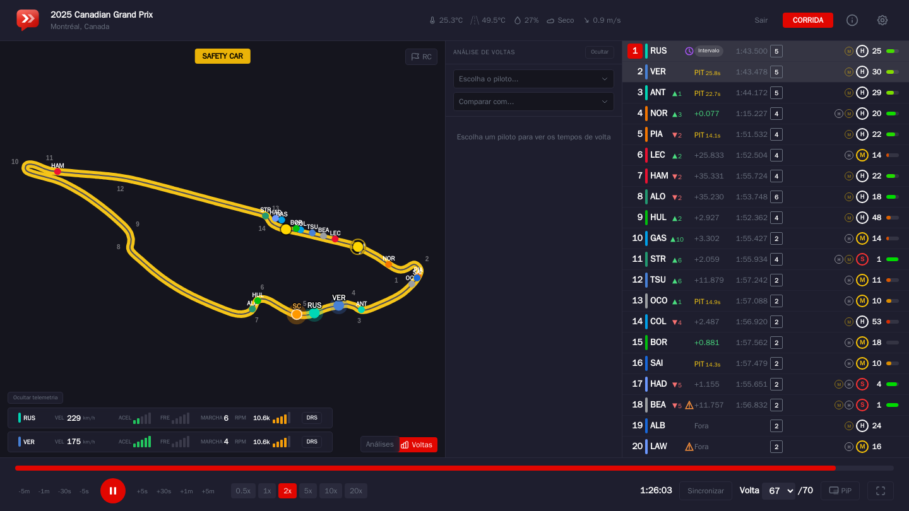

<p align="center">
  
</p>

<h1 align="center">Box Box</h1>

<p align="center">
  <strong>Reveja qualquer sessão da Fórmula 1 como se estivesse no muro dos boxes.</strong><br />
  Mapa da pista ao vivo, tabela de tempos, telemetria, estratégia de pneus e muito mais, em português e rodando no seu computador.
</p>

<p align="center">
  
</p>

<p align="center">
  <a href="box-box/docs/media/demo.mp4">▶ Ver o vídeo em alta qualidade (MP4)</a>
</p>

---

## Por que "Box Box"?

É o chamado que todo fã conhece: quando o engenheiro quer o piloto nos boxes, ele diz pelo rádio "box, box". O nome resume a ideia do projeto: trazer para a sua tela a visão de quem acompanha a corrida pelos dados, do pit wall. O logo segue a mesma ideia, com um balão de rádio e duas setas de entrada do pit, uma para cada "box".

## O que dá para fazer

### 🏁 Assistir a corrida de novo, com dados reais
- **Mapa da pista** com a posição de cada carro, atualizada duas vezes por segundo e com movimento suave.
- **Tabela de tempos** completa: posição, diferença para o líder e intervalo para o carro da frente, última volta, setores, pneu atual, idade e histórico de pneus, pit stops, ganho de posições desde a largada e quem fez a volta mais rápida.
- **Controles de reprodução** de 0,5x a 20x, saltos de 5 segundos a 5 minutos, escolha direta da volta e "pular para a relargada" depois de uma bandeira vermelha.
- **Situação da pista** setor por setor: amarela, amarela dupla, vermelha, Safety Car e Virtual Safety Car.
- **Mensagens da direção de prova** (investigações, punições, limites de pista) com cores para leitura rápida.
- **Clima** da sessão: temperatura do ar e da pista, umidade, vento e chuva.
- **Rádio das equipes** com áudio e legenda gerada no seu próprio computador (Whisper).

### 🛞 Estratégia e pneus
- **Saúde dos pneus**: um modelo bayesiano estima, volta a volta, quanto cada jogo de pneus já se desgastou. Ele aprende o ritmo de desgaste de cada composto com os dados da própria corrida, descontando o combustível e a abrasão do asfalto. Uma barrinha colorida na tabela mostra o resultado.
- **Estratégia de pneus**: as passagens de cada piloto por composto, novo ou usado, só até o momento do replay, sem spoilers.
- **Previsão de pit**: em que posição o piloto voltaria se parasse agora, e com quanta folga.
- **Campeonato ao vivo**: a classificação de pilotos e construtores "se a ordem ficar assim", partindo da tabela de antes da corrida. Nos fins de semana com Sprint, os pontos dela já entram na conta.
- **Safety Car simulado**: a F1 não divulga onde o Safety Car está, então o Box Box desenha um carro de segurança logo à frente do líder enquanto ele está na pista, com animação de entrada e de saída.

### 📈 Análise de desempenho
- **Telemetria** de quantos pilotos você quiser: velocidade, acelerador, freio, marcha e DRS ao longo da volta.
- **Análise de voltas**: gráfico de ritmo e lista volta a volta nas corridas; setores, voltas ideais e comparação entre as melhores voltas de dois pilotos na classificação e nos treinos.
- **Domínio na pista**: o mapa colorido por quem foi mais rápido em cada trecho da volta.
- **Minissetores** preenchidos em roxo, verde ou amarelo enquanto o piloto anda.

### 📺 Recursos extras
- **Cronometragem ao vivo** nos fins de semana de corrida, com controle de atraso para acompanhar a sua transmissão.
- **Transmissão do F1 TV** dentro do app, sincronizada com os dados, com câmeras onboard (exige F1 TV Pro ou Premium).
- **Sincronizar com uma gravação**: alinhe o replay com o que você está assistindo, por foto da tabela da TV ou digitando as diferenças.
- **Picture-in-Picture**, tela cheia, unidades imperiais e texto em alto contraste.
- **Alertas no celular**: largada, Safety Car, bandeira vermelha, troca de líder, última volta e pódio chegam como notificação na tela de bloqueio. No iPhone, o Box Box vira um app na Tela de Início.
- **Tela inicial** com o traçado e o nome oficial de cada circuito da temporada.

## Capturas de tela

| | |
|---|---|
|  |  |
| **Temporada**: cada etapa com o desenho da pista | **Replay**: mapa, tabela e controles |
|  |  |
| **Telemetria** de pilotos selecionados | **Estratégia** de pneus de toda a grade |
|  |  |
| **Campeonato** "se a ordem ficar assim" | **Modelo de pneus** ajustado à corrida |
|  |  |
| **Safety Car** simulado no fim da corrida | **Análise de voltas** ao lado do mapa, com telemetria ao vivo |

## De onde vêm os dados

O Box Box não guarda dados de ninguém nem depende de um servidor central. Cada sessão é baixada e processada uma única vez no seu computador e depois abre na hora.

| Fonte | Para quê | Precisa de conta? |
|---|---|---|
| [OpenF1](https://openf1.org) | Voltas, posições, telemetria, pneus, pit stops e direção de prova (2023 em diante) | Não |
| F1 TV (via [FastF1](https://github.com/theOehrly/Fast-F1)) | Dados direto da F1, sessões mais recentes e a transmissão | Sim, assinatura F1 TV |
| [Jolpica](https://github.com/jolpica/jolpica-f1) | Classificação do campeonato | Não |
| [MultiViewer](https://multiviewer.app) | Traçado e curvas de cada circuito | Não |

Sem login, o app usa o OpenF1 automaticamente. As corridas mais recentes podem levar alguns dias para chegar lá; se você tiver F1 TV, é só entrar pelo botão **F1 TV** no topo para baixá-las direto da F1.

## Como rodar

Você só precisa do [Docker Desktop](https://www.docker.com/products/docker-desktop/).

**1. Baixe o projeto**

```bash
git clone https://github.com/Wedrock/Projetos-F1.git
cd Projetos-F1/box-box
```

**2. Crie o arquivo de configuração**

```bash
cp .env.example .env
```

Abra o `.env` e preencha `F1TV_SECRET_KEY` com uma chave aleatória. É ela que protege o seu login do F1 TV, caso você use. Para gerar uma:

```bash
openssl rand -hex 32
```

**3. Suba o app**

```bash
docker compose up -d
```

**4. Abra** [http://localhost:8000](http://localhost:8000), escolha uma etapa e uma sessão. Na primeira vez, a sessão leva alguns minutos para baixar; depois disso, abre na hora.

## Usar no iPhone

O Box Box pode ser instalado no iPhone como um app (PWA), com ícone na Tela de Início e alertas de corrida na tela de bloqueio.

**1. Deixe o app acessível por HTTPS.** O iPhone só aceita notificações de sites com HTTPS. O jeito mais simples é rodar o Box Box no seu computador e expor ele com um túnel:

- **[Tailscale](https://tailscale.com)** (só você acessa): instale no computador e no iPhone, entre com a mesma conta e rode `tailscale serve --bg 8000`. O app fica em `https://nome-do-pc.seu-tailnet.ts.net`.
- **[Cloudflare Tunnel](https://developers.cloudflare.com/cloudflare-one/connections/connect-networks/)** (endereço na internet): aponte um domínio seu para `http://localhost:8000`. Nesse caso ligue `AUTH_ENABLED`.

Nos dois casos, adicione o endereço em `ALLOWED_HOSTS` no `.env`.

> Por que não num servidor na nuvem? A F1 bloqueia a cronometragem ao vivo vinda da maioria dos servidores na nuvem e VPNs, então os alertas param de funcionar. Rodando em casa, funciona.

**2. Instale no iPhone.** Abra o endereço no Safari, toque em **Compartilhar** → **Adicionar à Tela de Início** e abra o Box Box pelo ícone.

**3. Ligue os alertas.** Na tela inicial do app, abra o menu → **Alertas** → **Ligar alertas neste aparelho** e permita as notificações (precisa do iOS 16.4 ou mais novo). Chega uma notificação de teste na hora.

Durante as corridas, sprints e classificações, o servidor acompanha a cronometragem ao vivo e avisa:

| Quando | Exemplo |
|---|---|
| 15 minutos antes | ⏱️ Corrida em 15 min |
| Largada | 🏁 Largada! · VER sai na pole |
| Safety Car, VSC, bandeira vermelha | 🟡 Safety Car na pista · Volta 23/71 |
| Bandeira verde depois deles | 🟢 Safety Car recolhido |
| Novo líder | 🔄 NOR assume a liderança |
| Última volta | 🏁 Última volta! · VER lidera, NOR a 1.2s |
| Fim | 🏆 1º VER · 2º NOR · 3º LEC (ou a pole, na classificação) |

O computador com o Box Box precisa estar ligado durante a sessão, porque é ele que manda os alertas.

## Configuração

As opções ficam no `.env`. Todas têm um valor padrão sensato; mude só o que precisar.

| Variável | O que faz | Padrão |
|---|---|---|
| `PORT` | Porta do app no seu computador | `8000` |
| `DATA_SOURCE` | `auto` usa o OpenF1 sem login e o F1 TV com login; `openf1` ou `f1tv` forçam uma fonte | `auto` |
| `F1TV_SECRET_KEY` | Chave que criptografa o login do F1 TV salvo | — |
| `F1_USERNAME` / `F1_PASSWORD` | Login do F1 TV pelo arquivo, em vez de pela tela | — |
| `AUTO_PRECOMPUTE` | Baixa sessões sozinho nos fins de semana: `off`, `race`, `race+qual` ou `all` | `race+qual` |
| `BIND_ADDRESS` | Quem pode acessar a porta; `0.0.0.0` libera a rede local | `127.0.0.1` |
| `ALLOWED_HOSTS` | Endereços aceitos pelo servidor, separados por vírgula | `localhost,127.0.0.1` |
| `AUTH_ENABLED` / `AUTH_PASSPHRASE` | Pede uma frase de acesso para abrir o app | desligado |
| `TEAM_RADIO_CAPTIONS` / `TEAM_RADIO_MODEL` | Legendas do rádio e o modelo Whisper usado | ligado / `small.en` |
| `OPENROUTER_API_KEY` | Liga os recursos de IA (correção de legendas e sincronização por foto) | — |
| `STORAGE_MODE` | `local` ou `r2` (Cloudflare R2) para guardar as sessões | `local` |
| `PUSH_ALERTS` | Alertas de corrida no celular (notificações) | ligado |
| `PUSH_SESSIONS` | Sessões que mandam alertas | `R,S,Q,SQ` |

## Privacidade e segurança

- **Fica só no seu computador.** Por padrão a porta abre apenas em `127.0.0.1` e o servidor só responde a `localhost`, o que protege contra acesso pela rede e contra ataques de *DNS rebinding*. Para abrir na rede local, ajuste `BIND_ADDRESS` e `ALLOWED_HOSTS` e ligue `AUTH_ENABLED`: quem acessa o app pode usar o seu login do F1 TV.
- **Senha protegida.** O login do F1 TV fica criptografado no seu disco e só é enviado para a F1. Os registros do servidor nunca mostram senha, token ou e-mail.
- **Nada de rastreadores.** Sem analytics, sem scripts de terceiros. Os traçados dos circuitos e os dados das corridas são buscados pelo servidor, então o seu navegador só conversa com o próprio app.
- **IA desligada por padrão.** Nada é enviado a serviços de IA a menos que você configure `OPENROUTER_API_KEY`.

## Como o projeto é organizado

```
box-box/
├── backend/                 API em Python (FastAPI)
│   ├── routers/             Rotas: sessões, replay, telemetria, análises, circuitos...
│   ├── services/
│   │   ├── f1_data.py       Monta o replay a partir dos dados da sessão
│   │   ├── openf1_source.py Usa o OpenF1 como fonte quando não há login
│   │   ├── tyre_model.py    Modelo bayesiano de desgaste dos pneus
│   │   ├── standings.py     Classificação do campeonato
│   │   └── circuits.py      Nomes e traçados dos circuitos
│   └── tests/               Testes automáticos
├── frontend/                Interface em Next.js, React e Tailwind
│   └── src/
│       ├── app/             Páginas: início, replay, ao vivo, recursos, sobre
│       ├── components/      Mapa, tabela, telemetria, painel de análises...
│       └── lib/             Desenho da pista, modelo de pneus, utilidades
├── docs/media/              Vídeo e capturas deste README
├── Dockerfile               Um único contêiner com frontend e backend
└── docker-compose.yml
```

O frontend é compilado como site estático e servido pelo próprio backend, então tudo roda em um só contêiner e em uma só porta.

## Para desenvolvedores

Rodar os testes do backend sem instalar Python, usando o Docker:

```bash
docker run --rm -v "$(pwd)/backend:/app" -w /app python:3.12-slim sh -c "pip install -q numpy httpx pytest && python -m pytest -q tests"
```

Checar os tipos do frontend:

```bash
cd frontend && npm ci && npx tsc --noEmit
```

## Créditos

O Box Box nasceu da junção de dois projetos de código aberto, ambos sob a licença MIT:

- **[F1 Replay Timing](https://github.com/adn8naiagent/F1ReplayTiming)**: a base do app web, com o replay, a cronometragem ao vivo e a transmissão do F1 TV.
- **[F1 Race Replay](https://github.com/IAmTomShaw/f1-race-replay)**: de onde vieram o modelo de desgaste dos pneus, o Safety Car simulado, a estratégia de pneus e o campeonato ao vivo.

Também agradecemos ao [FastF1](https://github.com/theOehrly/Fast-F1), ao [OpenF1](https://openf1.org), ao [Jolpica](https://github.com/jolpica/jolpica-f1) e ao [MultiViewer](https://multiviewer.app) pelos dados.

## Licença

O código está sob a licença [MIT](box-box/LICENSE). Os dados do OpenF1 seguem a licença CC BY-NC-SA 4.0, ou seja, são para uso pessoal e não comercial.

## Aviso

O Box Box é um projeto independente de fãs. Não é oficial e não tem nenhuma ligação com as empresas da Fórmula 1.
